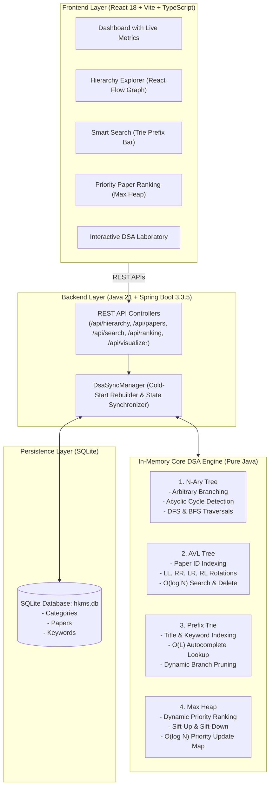

# Hierarchical Knowledge Management System (HKMS)
### Academic Full-Stack Data Structures and Algorithms Project

The **Hierarchical Knowledge Management System (HKMS)** is a high-performance research paper management platform designed to organize computer science research papers into subject-topic taxonomies, execute sub-millisecond prefix searches, maintain balanced indexes, and dynamically schedule papers by priority score.

> **Academic Rigor Guarantee:**
> All four data structures are implemented **purely from scratch** in Java 21 without relying on `TreeMap`, `PriorityQueue`, `TreeSet`, or third-party collection libraries. The data structures directly power live application features.

---

## 1. System Architecture & Core Data Structures



### 1. N-Ary Tree (`com.hkms.core.nary.NAryTree`)
- **Role**: Structures the knowledge taxonomy (`ROOT` $\rightarrow$ `SUBJECT` $\rightarrow$ `TOPIC` $\rightarrow$ `SUBTOPIC` $\rightarrow$ `PAPER`).
- **Algorithm Highlights**:
  - Arbitrary branching factor per node.
  - **Acyclic Graph Invariant**: During reparenting (`moveNode`), walks upwards from the destination to ensure it is not a descendant of the source node.
  - Complete Pre-order and Post-order Depth-First Search (DFS) and Level-order Breadth-First Search (BFS).
- **Time Complexity**: Insert $\mathcal{O}(1)$, Reparent $\mathcal{O}(D)$, Traversals $\mathcal{O}(N)$.

### 2. AVL Tree (`com.hkms.core.avl.AvlTree`)
- **Role**: Indexes research papers by unique ID for $\mathcal{O}(\log N)$ lookups.
- **Algorithm Highlights**:
  - Strict height tracking and balance factor calculation ($BF = \text{height}(L) - \text{height}(R)$).
  - Four fundamental rotation invariants:
    - **Single Right Rotation (LL)**
    - **Single Left Rotation (RR)**
    - **Double Left-Right Rotation (LR)**
    - **Double Right-Left Rotation (RL)**
  - Deletion with in-order successor and recursive ancestor rebalancing.
  - Rotation audit log for real-time visualization.
- **Time Complexity**: Search $\mathcal{O}(\log N)$, Insert $\mathcal{O}(\log N)$, Delete $\mathcal{O}(\log N)$, Space $\mathcal{O}(N)$.

### 3. Prefix Trie (`com.hkms.core.trie.Trie`)
- **Role**: Powers real-time autocomplete across paper titles, keywords, and author tags.
- **Algorithm Highlights**:
  - Multiway character tree mapping prefixes to sets of Paper IDs.
  - Frequency counters for ranking suggestions.
  - **Branch Pruning**: When deleting words, recursively prunes empty branch nodes if no other papers reference that path.
- **Time Complexity**: Search / Autocomplete $\mathcal{O}(L + K)$ where $L$ is prefix length and $K$ is number of matches. Typically executes in **$< 200 \mu s$**.

### 4. Binary Max Heap (`com.hkms.core.heap.MaxHeap`)
- **Role**: Schedules and ranks papers by priority score (0–100).
- **Algorithm Highlights**:
  - Contiguous 1D dynamic array representation with parent $\lfloor(i-1)/2\rfloor$ and children $2i+1, 2i+2$.
  - Peek Max in $\mathcal{O}(1)$ and Extract Max in $\mathcal{O}(\log N)$.
  - **$\mathcal{O}(\log N)$ Priority Update Optimization**: Uses an auxiliary `Map<Long, Integer> idToIndexMap` to instantly locate any paper in $\mathcal{O}(1)$ and sift up or down, avoiding linear $\mathcal{O}(N)$ scanning.
- **Time Complexity**: Peek $\mathcal{O}(1)$, Insert $\mathcal{O}(\log N)$, Extract-Max $\mathcal{O}(\log N)$, Priority Update $\mathcal{O}(\log N)$.

---

## 2. Directory Structure

```
HKMS_DSA_Project/
├── backend/
│   ├── pom.xml                                   # Maven dependencies (Java 21, Spring Boot 3.3.5, SQLite)
│   ├── src/main/java/com/hkms/
│   │   ├── HkmsApplication.java                  # Spring Boot main entry point
│   │   ├── config/                               # Web & CORS configuration
│   │   ├── core/                                 # PURE CUSTOM DSA IMPLEMENTATIONS
│   │   │   ├── nary/                             # NAryTree, NAryNode, TraversalResult
│   │   │   ├── avl/                              # AvlTree, AvlNode, RotationType, RotationEvent
│   │   │   ├── trie/                             # Trie, TrieNode, AutocompleteMatch
│   │   │   └── heap/                             # MaxHeap, HeapItem, HeapStepTrace
│   │   ├── model/                                # SQLite Entities & DTOs
│   │   ├── repository/                           # Spring Data JPA SQLite Repositories
│   │   ├── service/                              # DsaSyncManager & DataSeederService
│   │   └── controller/                           # REST API Controllers
│   └── src/test/java/com/hkms/core/              # 24 RIGOROUS JUNIT 5 TESTS
├── frontend/
│   ├── src/
│   │   ├── api/                                  # Axios API Client & Endpoints
│   │   ├── components/
│   │   │   ├── dashboard/                        # Metrics overview & quick actions
│   │   │   ├── hierarchy/                        # React Flow tree visualization & traversals
│   │   │   ├── papers/                           # Research Paper CRUD & Detail modals
│   │   │   ├── search/                           # Real-time Trie autocomplete search bar
│   │   │   ├── ranking/                          # Priority leaderboard & Extract-Max
│   │   │   └── visualizer/                       # AVL rotation explorer & Heap array viewer
│   │   ├── pages/                                # Top-level view pages
│   │   └── types/                                # TypeScript definitions
│   └── package.json
└── README.md
```

---

## 3. How to Run the Project

### Prerequisites
- **Java 21** (`temurin-21.jdk` installed at `/Library/Java/JavaVirtualMachines/temurin-21.jdk/Contents/Home`)
- **Maven** (`/opt/homebrew/bin/mvn`)
- **Node.js** (`v26.8.2` or later) & **npm**

### Step 1: Run Backend Unit Tests
Execute the comprehensive test suite verifying all 24 algorithmic tests:
```bash
export JAVA_HOME="/Library/Java/JavaVirtualMachines/temurin-21.jdk/Contents/Home"
export PATH="$JAVA_HOME/bin:/opt/homebrew/bin:$PATH"
cd backend
mvn test -Dmaven.repo.local=../.m2/repository
```

### Step 2: Start the Spring Boot Backend Server
```bash
export JAVA_HOME="/Library/Java/JavaVirtualMachines/temurin-21.jdk/Contents/Home"
export PATH="$JAVA_HOME/bin:/opt/homebrew/bin:$PATH"
cd backend
java -jar target/hkms-backend-1.0.0.jar
```
*The backend automatically creates `hkms.db`, seeds landmark papers and taxonomy categories, and hosts REST APIs on `http://localhost:8080`.*

### Step 3: Start the React Frontend
In a new terminal window:
```bash
cd frontend
npm run dev
```
*The frontend will be available at `http://localhost:5173`.*

---

## 4. Key REST API Endpoints

| Category | Method | Endpoint | Description |
| :--- | :--- | :--- | :--- |
| **Hierarchy** | `GET` | `/api/hierarchy` | Nested taxonomy tree |
| **Hierarchy** | `GET` | `/api/hierarchy/react-flow` | Graph nodes & edges for React Flow |
| **Hierarchy** | `POST` | `/api/hierarchy/move` | Reparents branch with cycle detection |
| **Hierarchy** | `GET` | `/api/hierarchy/traversals/bfs` | Level-order BFS traversal sequence |
| **Papers** | `GET` | `/api/papers` | All papers in-order from AVL Tree |
| **Papers** | `GET` | `/api/papers/{id}` | $\mathcal{O}(\log N)$ AVL lookup |
| **Papers** | `POST` | `/api/papers` | Creates paper & syncs to all 4 structures |
| **Search** | `GET` | `/api/search/autocomplete?query=...` | $\mathcal{O}(L)$ Trie prefix lookup |
| **Ranking** | `GET` | `/api/ranking/top?limit=10` | Top-K papers from Max Heap |
| **Ranking** | `POST` | `/api/ranking/extract-max` | Pops root highest-priority paper |
| **Ranking** | `PATCH` | `/api/ranking/{id}/priority` | $\mathcal{O}(\log N)$ priority update |
| **Visualizer** | `GET` | `/api/visualizer/summary` | Live DSA audit status |
| **Visualizer** | `GET` | `/api/visualizer/avl` | AVL tree structure with rotation trace |
| **Visualizer** | `GET` | `/api/visualizer/heap` | 1D memory array view with swap traces |
| **Visualizer** | `GET` | `/api/visualizer/complexities` | Theoretical Big-O complexity matrix |
